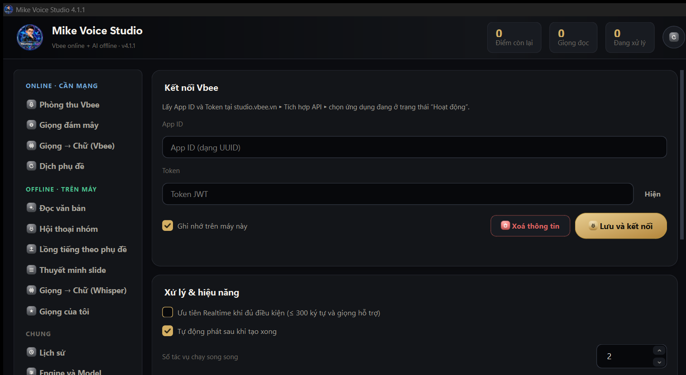
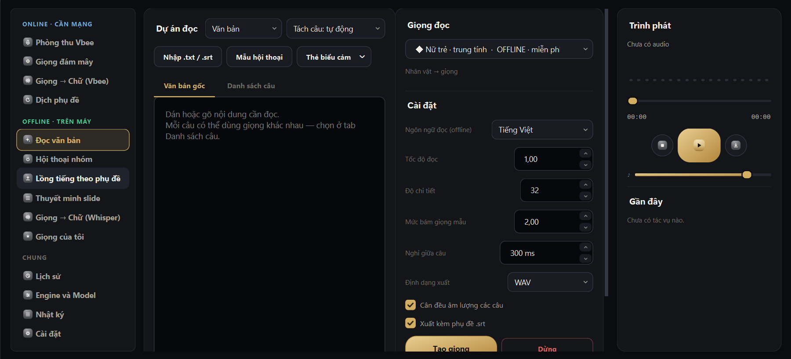
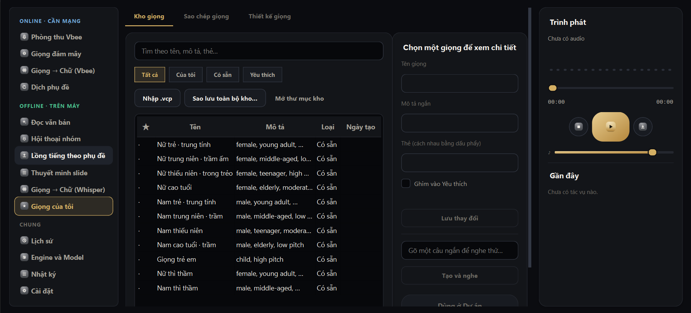
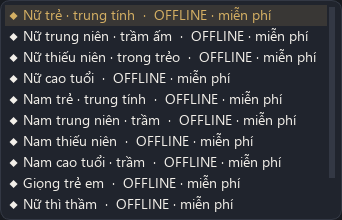

<h1 align="center">Mike Voice Studio</h1>

<p align="center"><b>Đọc văn bản thành giọng nói, lồng tiếng, nhận dạng giọng nói và dịch phụ đề — vừa ONLINE (Vbee · Edge · OpenAI · Gemini) vừa OFFLINE ngay trên máy (OmniVoice · Whisper). Ứng dụng Windows bằng tiếng Việt.</b></p>

<p align="center">🇻🇳 <b>Tiếng Việt</b> · 🇬🇧 <a href="#english">English</a></p>

<p align="center">
  <a href="https://github.com/mikeTran99/MikeVoice-Studio/releases/latest/download/MikeVoice-Setup.exe"></a>
  <a href="https://github.com/mikeTran99/MikeVoice-Studio/releases/latest"></a>
  <a href="THIRD_PARTY_NOTICES.txt"></a>
</p>
<p align="center">
  
  
  
  
  
  
</p>

<p align="center">
  <a href="#-tải-về">📥 Tải về</a> ·
  <a href="#-tính-năng">✨ Tính năng</a> ·
  <a href="#-chi-phí--giọng-nào-tốn-tiền">💰 Chi phí</a> ·
  <a href="#-yêu-cầu-hệ-thống">💻 Yêu cầu</a> ·
  <a href="#-cài-đặt-cập-nhật-gỡ-bỏ">🛠️ Cài đặt</a> ·
  <a href="#-hỏi--đáp">❓ Hỏi đáp</a> ·
  <a href="#-quyền-riêng-tư">🔒 Riêng tư</a> ·
  <a href="#-giấy-phép--thành-phần-đi-kèm">⚖️ Giấy phép</a>
</p>

> **Bản hiện tại: [4.1.1 · 17/10/2026](https://github.com/mikeTran99/MikeVoice-Studio/releases/latest).** Engine offline hết lỗi *junction* của uv và tự phục hồi; điểm Vbee chỉ hiện khi đã đăng nhập; **tách kho giọng** OFFLINE / ONLINE; bản dựng **native Nuitka**. Xem [CHANGELOG.md](CHANGELOG.md).

<p align="center"></p>

<sub>Ảnh minh họa đã che đường dẫn thư mục dữ liệu của máy chụp. Ô App ID / Token để trống — ứng dụng không kèm sẵn khoá nào.</sub>

---

## 📥 Tải về

Vào **[Releases](https://github.com/mikeTran99/MikeVoice-Studio/releases/latest)** và chọn một cách (khuyên dùng **bộ cài**):

| | Tệp | Dùng khi | Ghi chú |
|:-:|---|---|---|
| ⭐ | **[MikeVoice-Setup.exe](https://github.com/mikeTran99/MikeVoice-Studio/releases/latest/download/MikeVoice-Setup.exe)** | **Cài mới / cài lại (khuyên dùng)** | Bộ cài từng bước: chọn thư mục → lối tắt Desktop → Cài đặt. Không cần quyền quản trị. |
| 📦 | **[MikeVoice-win.zip](https://github.com/mikeTran99/MikeVoice-Studio/releases/latest/download/MikeVoice-win.zip)** | Cài bằng script | Giải nén **cả thư mục** rồi bấm đúp `Cai_dat.cmd`. |
| 🔐 | **[SHA256SUMS.txt](https://github.com/mikeTran99/MikeVoice-Studio/releases/latest/download/SHA256SUMS.txt)** | Kiểm tra tệp tải về | Đối chiếu mã SHA-256 trước khi chạy. |

Kiểm tra tệp tải về (PowerShell):

```powershell
Get-FileHash .\MikeVoice-Setup.exe -Algorithm SHA256   # so với dòng tương ứng trong SHA256SUMS.txt
```

> [!TIP]
> Nếu Windows hiện bảng xanh **"Windows protected your PC"** (SmartScreen): bấm **More info** → **Run anyway**. Bản phát hành **chưa có chứng thư ký mã**, nên Windows cảnh báo ở lần chạy đầu — đây không phải virus. Hãy luôn tải từ trang Releases chính thức và đối chiếu SHA-256.

---

## ✨ Tính năng

Menu dọc bên trái chia ba nhóm. Rê chuột lên từng mục để biết mục đó online hay offline, có tốn tiền hay không.

### 🔵 ONLINE · CẦN MẠNG

| Mục | Làm được gì | Chi phí |
|---|---|---|
| **Phòng thu Vbee** | Đọc văn bản bằng **hơn 1.700 giọng Vbee**, 52 ngôn ngữ; tìm không dấu, lọc theo lĩnh vực / vùng miền / giới tính; nghe thử miễn phí; mp3 / wav, tốc độ, nhấn nhá, ngắt nghỉ; Batch tới 100.000 ký tự hoặc Realtime; phiên âm Hán Việt | Trừ **điểm Vbee** theo ký tự |
| **Giọng đám mây** | Giọng **Windows** (có sẵn trong máy), **Edge**, **ChatGPT (OpenAI)**, **Google Gemini**: nhập khoá API, danh sách giọng, nghe thử | Windows & Edge miễn phí · OpenAI / Gemini tính vào **tài khoản của bạn** |
| **Giọng → Chữ (Vbee)** | Kéo thả mọi định dạng audio / video, xuất `.txt` / `.srt` / `.vtt` | Theo gói Vbee |
| **Dịch phụ đề** | Dịch `.srt` bằng **ChatGPT / Gemini**: giữ mốc thời gian, lập bảng tên riêng để dịch nhất quán, gửi thẳng sang Lồng tiếng | Tính vào khoá OpenAI / Google của bạn |

### 🟢 OFFLINE · TRÊN MÁY

| Mục | Làm được gì | Chi phí |
|---|---|---|
| **Đọc văn bản** | Dự án đọc dài: tách câu, **mỗi câu một giọng**, thẻ biểu cảm, trộn + cân đều âm lượng, xuất WAV / MP3 kèm `.srt`, tạo lại từng câu | Giọng offline miễn phí; nhãn từng giọng cho biết câu nào tốn tiền |
| **Hội thoại nhóm** | Kịch bản `Tên: lời`, **mẫu hội thoại**, gán giọng và **tốc độ riêng từng nhân vật** | như trên |
| **Lồng tiếng theo phụ đề** | Đọc `.srt` khớp đúng mốc thời gian | như trên |
| **Thuyết minh slide** | Đọc ghi chú (không có thì chữ trên slide) của `.pptx`, tạo audio từng slide theo tốc độ đọc, xuất **WAV + .srt**, **PPTX có thuyết minh**, **video MP4** (cần PowerPoint) | như trên |
| **Giọng → Chữ (Whisper)** | Nhận dạng trên máy, **chia lại phụ đề** không cần nhận dạng lại, nút *Lồng tiếng lại* | Miễn phí |
| **Giọng của tôi** | **Sao chép giọng** từ tệp audio / video (tự chọn đoạn rõ nhất, tự nhận lời), **thiết kế giọng bằng mô tả** (giới tính · tuổi · cao độ · thì thầm), 11 giọng có sẵn, gói `.vcp`, sao lưu kho | Miễn phí |

<table>
<tr>
<td width="50%"><br><sub><b>Đọc văn bản</b> — mỗi câu một giọng, xuất WAV / MP3 kèm .srt</sub></td>
<td width="50%"><br><sub><b>Giọng của tôi</b> — sao chép giọng, thiết kế giọng, kho giọng .vcp</sub></td>
</tr>
</table>

<p align="center"><br><sub>Mỗi giọng có nhãn <b>OFFLINE · miễn phí</b> hoặc <b>ONLINE · tốn điểm</b>; kho giọng OFFLINE chỉ liệt kê giọng offline, kho ONLINE chỉ liệt kê giọng online.</sub></p>

### ⚪ CHUNG

| Mục | Làm được gì |
|---|---|
| **Lịch sử** | Mọi tệp đã tạo và đã nhận dạng |
| **Engine và Model** | Cài **engine offline** bằng một nút, chọn model AI, phần cứng (GPU / CPU), đổi thư mục engine, **REST API cục bộ** có `X-API-Key` cho n8n / Make / Zapier |
| **Nhật ký** | Mọi lượt gọi và lỗi; **Xuất .txt** để gửi khi báo lỗi — Token và App ID luôn được che |
| **Cài đặt** | Kết nối Vbee, 5 bộ màu, Tiếng Việt / English (đổi nóng), cỡ chữ |

**Điểm Vbee tự đồng bộ:** đăng nhập Vbee một lần ngay trong ứng dụng (ứng dụng không thấy mật khẩu Google của bạn); số **"Điểm còn lại"** đọc thẳng từ máy chủ Vbee. Chưa đăng nhập hoặc đã đăng xuất thì hiện **0**.

---

## 💰 Chi phí — giọng nào tốn tiền?

| Nguồn giọng | Chi phí |
|---|---|
| **Vbee** | Trừ **điểm Vbee** theo số ký tự (hiện ở đầu cửa sổ và từng câu của dự án). Nghe mẫu giọng miễn phí |
| **OpenAI**, **Google Gemini** (đọc giọng, dịch phụ đề) | Tính phí vào **tài khoản OpenAI / Google của bạn** (khoá API của bạn) |
| **Edge** | Miễn phí, cần mạng |
| **Windows** | Miễn phí, offline (giọng có sẵn của Windows) |
| **OmniVoice** (engine offline) | Miễn phí, chạy trên máy — trọng số model theo giấy phép **CC BY-NC, chỉ dùng phi thương mại** (xem [Giấy phép](#-giấy-phép--thành-phần-đi-kèm)) |
| **Whisper** (nhận dạng offline) | Miễn phí |

Mike Voice Studio **không bán điểm, không thu phí thay các nhà cung cấp**: bạn dùng tài khoản và khoá API của chính mình.

---

## 💻 Yêu cầu hệ thống

| | Thành phần | Yêu cầu |
|:-:|---|---|
| 🪟 | Hệ điều hành | Windows 10 / 11 **64-bit** |
| 🖥️ | Màn hình | Từ **1024 × 600** trở lên (laptop 1366 × 768 dùng thoải mái) |
| 🎮 | Card đồ họa (cho OFFLINE) | **Khuyên dùng card NVIDIA** — engine offline chạy nhanh trên GPU; không có GPU vẫn chạy được (CPU), chậm hơn |
| 💾 | Ổ đĩa | Engine offline **tải về ở lần dùng đầu (khoảng 3 GB**: Python + PyTorch CUDA; sau đó là model) và nằm trong *thư mục engine*, mặc định ở **ổ không phải ổ hệ thống** (đổi được) |
| 🌐 | Mạng | Cần cho nhóm ONLINE và khi tải engine / model lần đầu. Nhóm OFFLINE **không cần mạng** sau khi đã tải xong |
| 📎 | Microsoft PowerPoint (tuỳ chọn) | Chỉ cần khi xuất PPTX / MP4 ở trang Thuyết minh slide |

---

## 🛠️ Cài đặt, cập nhật, gỡ bỏ

**Cài mới**

1. Tải **`MikeVoice-Setup.exe`** ở [Releases](https://github.com/mikeTran99/MikeVoice-Studio/releases/latest) (hoặc `MikeVoice-win.zip` rồi chạy `Cai_dat.cmd`).
2. Bấm đúp → bộ cài **đề xuất thư mục cùng ổ với nó** (nên để ổ khác ổ C) → ☑ lối tắt Desktop → **Cài đặt** → ☑ **Mở Mike Voice ngay**. Không cần quyền quản trị.
3. Nếu Windows hiện cảnh báo SmartScreen, xem [ghi chú ở trên](#-tải-về).
4. Dùng nhóm OFFLINE: mở **CHUNG › Engine và Model** → **Cài engine offline** (lần đầu tải khoảng 3 GB).

**Cập nhật** — tải bản mới, chạy lại `MikeVoice-Setup.exe` (hoặc `Cai_dat.cmd`). Bộ cài tự đóng app đang mở, thay đúng chỗ; **dữ liệu, giọng và engine offline được giữ nguyên.**

**Gỡ cài đặt** — **Settings › Apps › Mike Voice Studio › Uninstall**. Chỉ xoá chương trình; **dữ liệu** (dự án, lịch sử, audio) và **engine offline** vẫn được giữ lại. Muốn xoá hẳn, tự xoá hai thư mục đó.

> [!NOTE]
> Dữ liệu của app luôn nằm **cùng ổ với app**: app ở ổ D thì dữ liệu ở `D:\MikeVoiceStudio\data`. Chỉ khi app nằm ở ổ C, dữ liệu mới vào `%LOCALAPPDATA%\MikeVoiceStudio`.

Hướng dẫn từng bước kèm bản đồ menu: **[docs/HUONG_DAN_KHACH_HANG.md](docs/HUONG_DAN_KHACH_HANG.md)**.

---

## ❓ Hỏi & đáp

<details>
<summary><b>Windows báo "Windows protected your PC" — có an toàn không?</b></summary>
<br>
Bản phát hành chưa có chứng thư ký mã Windows nên SmartScreen hỏi lại ở lần đầu. Bấm <b>More info → Run anyway</b>. Để yên tâm, đối chiếu SHA-256 của tệp tải về với <code>SHA256SUMS.txt</code> trên trang Releases.
</details>

<details>
<summary><b>Không có card NVIDIA có dùng được OFFLINE không?</b></summary>
<br>
Được, engine chạy bằng CPU nhưng chậm hơn rõ rệt. Card NVIDIA (CUDA) được khuyên dùng để đọc và nhận dạng nhanh.
</details>

<details>
<summary><b>Vì sao điểm Vbee hiện 0?</b></summary>
<br>
Điểm chỉ hiện khi bạn đã đăng nhập Vbee trong ứng dụng (<b>Cài đặt › Tài khoản Vbee</b>). Chưa đăng nhập, đã đăng xuất hoặc đã xoá thông tin API thì hiện 0 để không hiển thị số điểm cũ của phiên trước.
</details>

<details>
<summary><b>Dùng giọng OmniVoice để làm nội dung kiếm tiền được không?</b></summary>
<br>
Không. Trọng số model OmniVoice theo giấy phép <b>CC BY-NC (chỉ phi thương mại)</b>. Nếu cần dùng thương mại, hãy chọn giọng Vbee, OpenAI hoặc Gemini theo điều khoản của từng nhà cung cấp. Không sao chép giọng của người khác khi chưa được họ đồng ý.
</details>

<details>
<summary><b>Engine offline tải bao nhiêu và lưu ở đâu?</b></summary>
<br>
Khoảng 3 GB ở lần đầu (Python + PyTorch CUDA), sau đó là model. Mọi thứ nằm trong <i>thư mục engine</i> — mặc định ở ổ không phải ổ hệ thống, đổi được ở <b>Engine và Model › Đổi thư mục engine</b> trước khi cài.
</details>

<details>
<summary><b>Engine offline lúc chạy lúc không, báo lỗi liên quan "junction"?</b></summary>
<br>
Đã sửa từ <b>4.1.1</b>: engine không còn phụ thuộc junction của uv và tự phục hồi. Hãy cập nhật lên bản mới nhất.
</details>

<details>
<summary><b>Báo lỗi như thế nào?</b></summary>
<br>
Mở <b>CHUNG › Nhật ký → Xuất .txt</b> rồi đính kèm khi mở Issue (Token và App ID đã được che sẵn). Cần kiểm tra môi trường thì chạy <code>MikeVoice_Vbee.exe --self-test</code>; báo cáo lưu ở <code>&lt;thư mục dữ liệu&gt;\logs\self-test.txt</code>.
</details>

---

## 🔒 Quyền riêng tư

> [!IMPORTANT]
> **Xử lý OFFLINE nằm hoàn toàn trên máy bạn:** văn bản, audio và giọng sao chép không được gửi đi đâu. Nhóm ONLINE chỉ gửi nội dung tới dịch vụ bạn chọn (Vbee, Microsoft Edge TTS, OpenAI, Google Gemini) theo điều khoản của dịch vụ đó.

- **Khoá API và phiên đăng nhập** (Vbee App ID / Token, OpenAI, Gemini) được cất trong **Windows Credential Manager**, không nằm trong tệp văn bản và luôn được che trong nhật ký.
- Ứng dụng **không bao giờ thấy mật khẩu Google**: trang đăng nhập Vbee chạy trong trình duyệt nhúng, ứng dụng chỉ nhận phiên sau khi Vbee xác thực xong.
- REST API cục bộ của engine chỉ lắng nghe trên `127.0.0.1` và đòi `X-API-Key`.
- Dữ liệu (dự án, lịch sử, audio) nằm trong thư mục dữ liệu cùng ổ với app, bạn tự quản lý và tự xoá.

---

## ⚖️ Giấy phép & thành phần đi kèm

© 2026 [mikeTran99](https://github.com/mikeTran99). Ứng dụng phát hành dạng tệp chạy; **kho này chỉ chứa tài liệu**, mã nguồn không công khai.

- Thành phần mã nguồn mở đi kèm (Python, Qt / PySide6, httpx, edge-tts, keyring…) và giấy phép của chúng: **[THIRD_PARTY_NOTICES.txt](THIRD_PARTY_NOTICES.txt)**.
- **OmniVoice:** mã nguồn Apache-2.0, nhưng **trọng số model theo CC BY-NC — chỉ dùng phi thương mại**. Trọng số **không đi kèm** ứng dụng; bạn tự tải khi bấm *Cài engine offline*. faster-whisper / Whisper: MIT. PyTorch: BSD 3-Clause (kèm thư viện CUDA của NVIDIA theo giấy phép NVIDIA).
- Vbee, Microsoft Edge TTS, OpenAI, Google Gemini là dịch vụ của bên thứ ba. Mike Voice Studio là ứng dụng độc lập, **không liên kết hay được bảo trợ** bởi các nhà cung cấp này.

## 📚 Tài liệu

| | |
|---|---|
| 📘 | [Hướng dẫn sử dụng cho khách hàng](docs/HUONG_DAN_KHACH_HANG.md) |
| 📜 | [Nhật ký thay đổi — CHANGELOG.md](CHANGELOG.md) |
| 🏷️ | [Ghi chú phát hành 4.1.1](RELEASE_NOTES_v4.1.1.md) · [mọi bản phát hành](https://github.com/mikeTran99/MikeVoice-Studio/releases) |
| ⚖️ | [Thông báo thành phần mã nguồn mở](THIRD_PARTY_NOTICES.txt) |

---

## English

<a id="english"></a>

**Mike Voice Studio** is a Windows 10/11 desktop app for text-to-speech, voice dubbing, speech-to-text and subtitle translation, with a Vietnamese/English interface. It works both **online** and **offline**:

- **ONLINE (needs internet):** Vbee studio (1,700+ voices, billed in Vbee credits), cloud voices (Windows, Edge, OpenAI, Google Gemini), Vbee speech-to-text, and subtitle translation with ChatGPT / Gemini (billed to your own OpenAI / Google account).
- **OFFLINE (on your PC, free):** read text with a different voice per sentence, group dialogue with per-character voice and speed, dubbing from `.srt`, PowerPoint slide narration (WAV + .srt, PPTX, MP4), Whisper transcription with subtitle re-chunking, voice cloning and voice design. Powered by OmniVoice and Whisper.
- **Requirements:** Windows 10/11 64-bit. An NVIDIA GPU is recommended for offline mode (CPU works, slower). The offline engine (~3 GB, Python + PyTorch CUDA) is downloaded on first use into a folder on a non-system drive; models follow.
- **Install:** download `MikeVoice-Setup.exe` from [Releases](https://github.com/mikeTran99/MikeVoice-Studio/releases/latest), verify it against `SHA256SUMS.txt`. The build is **unsigned**, so SmartScreen may warn on first run (More info → Run anyway). Updating keeps your data; uninstalling keeps data and the offline engine.
- **Privacy:** API keys live in Windows Credential Manager; offline processing never leaves your machine.
- **License notes:** this repository contains documentation only; the app source is not public. OmniVoice **model weights are CC BY-NC (non-commercial use only)** and are downloaded by you, not bundled. Third-party components: [THIRD_PARTY_NOTICES.txt](THIRD_PARTY_NOTICES.txt). Not affiliated with Vbee, Microsoft, OpenAI or Google.

<p align="center"><sub>Làm cho người dùng Việt 🇻🇳 · Nếu thấy hữu ích, hãy bấm ⭐ cho dự án</sub></p>
